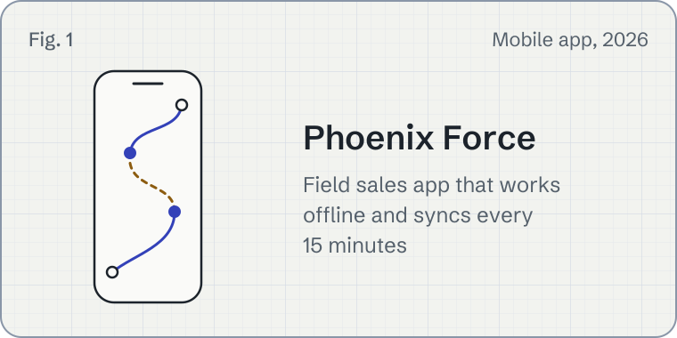
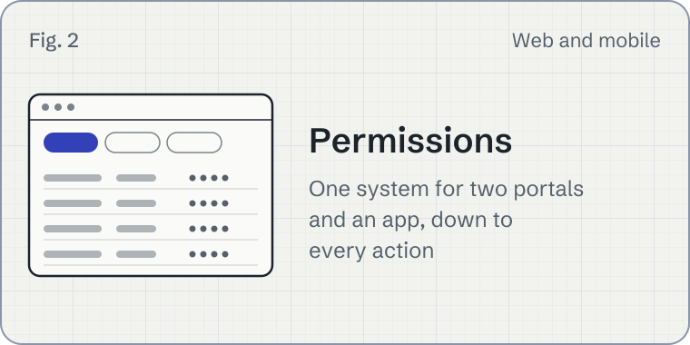
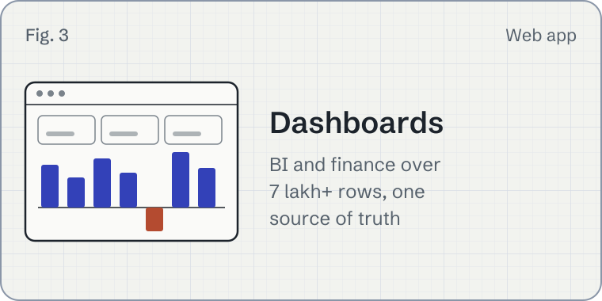
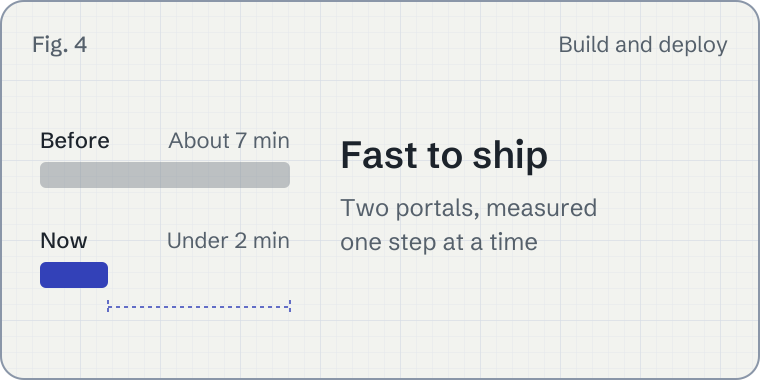
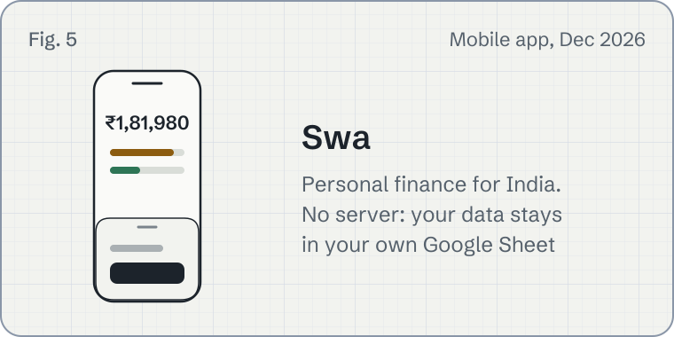
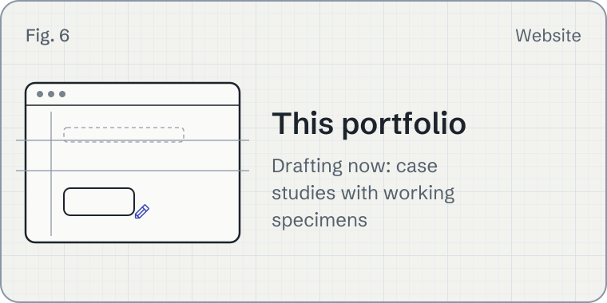
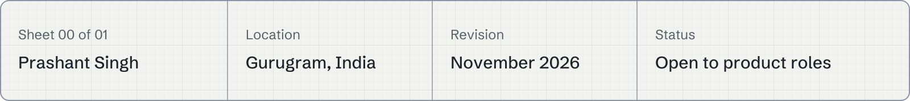

<picture>
  <source media="(prefers-color-scheme: dark)" srcset="./assets/banner-dark.svg">
  
</picture>

I'm a frontend engineer in Gurugram. For three years at AegisCovenant I've built the dashboards, policy workflows and field sales app behind an insurance platform for vehicle dealerships. A good first impression is the easy part; I care about the whole visit, so the ease lasts until people have done what they came to do.

<picture>
  <source media="(prefers-color-scheme: dark)" srcset="./assets/rule-01-dark.svg">
  
</picture>

### What I'm building

  <picture>
    <source media="(prefers-color-scheme: dark)" srcset="./assets/plate-phoenix-dark.svg">
    
  </picture>
  <picture>
    <source media="(prefers-color-scheme: dark)" srcset="./assets/plate-permissions-dark.svg">
    
  </picture>
  <picture>
    <source media="(prefers-color-scheme: dark)" srcset="./assets/plate-dashboards-dark.svg">
    
  </picture>
  <picture>
    <source media="(prefers-color-scheme: dark)" srcset="./assets/plate-pipeline-dark.svg">
    
  </picture>
  <picture>
    <source media="(prefers-color-scheme: dark)" srcset="./assets/plate-swa-dark.svg">
    
  </picture>
  <picture>
    <source media="(prefers-color-scheme: dark)" srcset="./assets/plate-portfolio-dark.svg">
    
  </picture>

- **Phoenix Force.** A React Native field sales app that keeps working when the network doesn't. I led it from scratch in 2026 to replace a paid tool, and the whole field team now uses it.
- **One permission system for three products.** Roles stay a fixed set and each person's access comes from the server, down to every action. It serves two web portals and Phoenix Force.
- **Business dashboards.** BI and finance dashboards over more than 7 lakh rows. Business development used them to find loss making regions and insurer deals, and renegotiate with the numbers.
- **Making two portals fast to ship.** Deploy pipelines from about 7 minutes to under 2, and a production build from 101 seconds to under 7, one measured step at a time.
- **Swa.** A personal finance app for India with no server: your data stays on your phone and in your own Google Sheet. Launching on Google Play in December 2026.

Most of this work sits behind company logins. My portfolio, coming soon, shows each project as a small working rebuild with invented data.

<picture>
  <source media="(prefers-color-scheme: dark)" srcset="./assets/rule-02-dark.svg">
  
</picture>

### How I work

 **I design the states, not just the screen.** Loading, empty, error and "you can't do this" get the same care as the happy path.

 **I write the decision down.** Decision records, measured before and after, including what got worse.

 **I stay after launch.** I've worked on the same production platform since 2023: reviewing pull requests, mentoring newer engineers, and owning the frontend during incidents and releases.

<picture>
  <source media="(prefers-color-scheme: dark)" srcset="./assets/rule-03-dark.svg">
  
</picture>

### Stack

**Every day:** React, TypeScript, Next.js, React Native with Expo, Tailwind CSS, TanStack Query and Table, Redux and Zustand, Vite

**Also:** Node.js, Express, AWS (Cognito, DynamoDB, S3, Lambda), Vitest and Jest, PostHog, Figma

<picture>
  <source media="(prefers-color-scheme: dark)" srcset="./assets/rule-04-dark.svg">
  
</picture>

### Now

SDE 1 at AegisCovenant, and getting Swa ready for Google Play. Next, I'm looking for a product frontend role with room to grow toward tech lead, remote or in Delhi NCR.

<picture>
  <source media="(prefers-color-scheme: dark)" srcset="./assets/rule-05-dark.svg">
  
</picture>

### Contact

Email is the best way to reach me: [prashantsingh.999000@gmail.com](mailto:prashantsingh.999000@gmail.com). You can also [connect with me on LinkedIn](https://www.linkedin.com/in/prashant17-11/) or [see my résumé](https://drive.google.com/file/d/1hq2we2n5myg1kXI79HtS2uuQC-pMtnJR/view).

<picture>
  <source media="(prefers-color-scheme: dark)" srcset="./assets/footer-dark.svg">
  
</picture>
